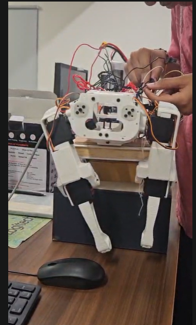
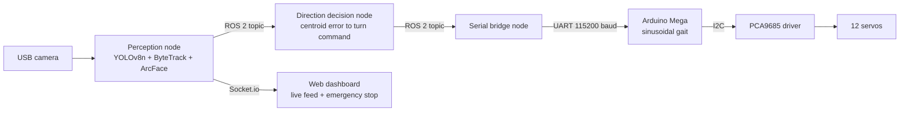

# Nova Spot Micro: Edge-AI Owner Recognition and Following Quadruped

A low-cost, four-legged robot that recognises its owner and follows them, with all AI running on the robot itself. Built as an assistive companion for elderly people at home, where reliability, low latency and privacy matter more than raw power.

The robot body is reproduced from the open-source [NovaSM3](https://novaspotmicro.com/) design by Chris Locke (see [Credits](#credits)). Our work is the edge-AI perception, owner following, ROS 2 integration and performance profiling built on top of it.
> **Report & Demo:** (https://drive.google.com/drive/folders/1kGzklXmjUZNO9u13_W2ifjQxaZidoWdP?usp=sharing)

  

---

## Why we built it

Elderly people living at home often face disorientation, reduced mobility and a higher risk of falls. An assistive robot can help, but only if it reacts fast and works without depending on the internet.

Cloud-based robots add network delay, need a stable connection, and send face data off the device. For a robot walking next to an elderly person, a slow reaction can mean a collision. So we kept everything on the edge: detection, tracking and face verification all run on the robot, and no biometric data leaves it.

## System overview

The robot uses two computers with separate jobs, so heavy AI processing never interferes with precise motor timing:

- **NVIDIA Jetson Orin Nano (8 GB):** runs the full perception pipeline.
- **Arduino Mega 2560:** generates the walking gait and drives 12 servos through a PCA9685 PWM driver.

### Perception pipeline

| Stage | Model | Precision | Why this choice |
| --- | --- | --- | --- |
| Detection | YOLOv8n | INT8 (TensorRT) | Fast enough for real time (3.95 ms) with good accuracy |
| Tracking | ByteTrack | n/a | Keeps the same ID through occlusions better than SORT |
| Verification | ArcFace (MobileNet) | FP16 (TensorRT) | Small (9.1 MB); face embeddings lose too much accuracy at INT8 |

### Control loop

1. The camera captures a frame.
2. The pipeline detects people, tracks them, and verifies which one is the owner.
3. The decision node measures how far the owner is from the centre of the frame and turns it into a turn command.
4. The serial bridge sends the command to the Arduino over UART.
5. The Arduino adjusts the stride of specific legs to turn, and writes servo angles through I2C.
6. If no valid command arrives for 500 ms, the Arduino stops all movement as a safety failsafe.

### ROS 2 structure

Three nodes keep perception separate from hardware control: a **perception node** (publishes detections), a **direction decision node** (turns detections into control commands), and a **serial bridge node** (sends commands to the Arduino). A Node.js and Socket.io dashboard shows the live camera feed and telemetry, with a remote emergency stop.

## Results

Measured on the Jetson Orin Nano using `jtop` and `psutil`.

### Model performance

| Metric | Value |
| --- | --- |
| YOLOv8n (INT8) mAP@50 | 0.899 |
| YOLOv8n (INT8) precision / recall / F1 | 0.923 / 0.833 / 0.880 |
| ByteTrack IDF1 | 0.658 |
| ArcFace (FP16) true accept rate | 99.10% |
| ArcFace (FP16) equal error rate | 1.28% |

### System performance

| Metric | Value |
| --- | --- |
| End-to-end latency (camera to motor command) | 60 ms |
| Throughput | 15 to 20 FPS |
| YOLOv8n INT8 inference | 3.95 ms |
| ArcFace FP16 inference | 6.03 ms |
| Power draw | 4.5 W idle, 12.8 W peak while walking |
| Average CPU use | 51% (ByteTrack's Kalman filtering is CPU-bound) |

## Limitations

- **Bang-bang steering:** turn commands are all-or-nothing (full left or full right), which causes jerky motion and current spikes in the servos.
- **Static quantization:** each model uses one precision for all its layers.
- **Single camera:** no depth sensing, so the robot follows by direction, not distance.

## Future work

- Replace bang-bang steering with a PID controller for smoother turns.
- Apply mixed-precision quantization per layer. We explored this in a separate project using reinforcement learning: [Hardware-Aware RL for Mixed-Precision Quantization](https://github.com/TanmayeeMahesh/Hardware-aware-RL-Quantization-Project).
- Add depth sensing to keep a safe following distance.

## Tech stack

Python, C++ (Arduino), ROS 2, TensorRT, YOLOv8, ByteTrack, ArcFace, OpenCV, NumPy, Node.js, Socket.io, NVIDIA Jetson Orin Nano, Arduino Mega 2560, PCA9685

## Team

| Name |
| --- |
| Sachin Bhat | 
| Priyanka Bhatt | 
| Tanmayee K M | 

Built at the School of Computational and Data Sciences, Vidyashilp University, Bengaluru.

## Credits

The mechanical design of this robot is not our own. We 3D-printed and assembled it from existing open-source work:

NovaSM3 by Chris Locke (novaspotmicro.com, GitHub): the STL files and build design we reproduced.
Spot Micro by Deok-yeon Kim (Thingiverse): the original 3D design that NovaSM3 is based on.

Both are inspired by Boston Dynamics' Spot. Thank you to these creators for sharing their work openly.

## References

- Ultralytics, YOLOv8, 2023.
- Y. Zhang et al., "ByteTrack: Multi-Object Tracking by Associating Every Detection Box," ECCV 2022.
- J. Deng et al., "ArcFace: Additive Angular Margin Loss for Deep Face Recognition," CVPR 2019.
- K. Wang et al., "HAQ: Hardware-Aware Automated Quantization with Mixed Precision," CVPR 2019.
